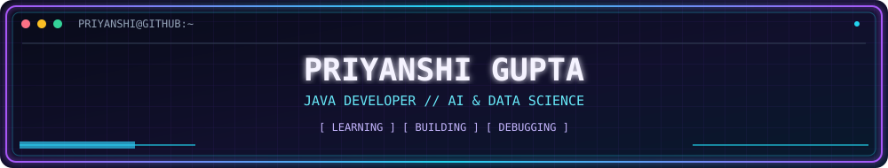

 

 

# 💜 PRIYANSHI GUPTA

---

## 🖥️ 💜 `// SYSTEM.INFO`

<table>
<tr><td>◈ <b>ROLE</b></td><td>Student Developer</td></tr>
<tr><td>◈ <b>FOCUS</b></td><td>Java · Problem Solving · AI & Data Science</td></tr>
<tr><td>◈ <b>CORE</b></td><td>Python · Java · MySQL</td></tr>
<tr><td>◈ <b>STATUS</b></td><td>Learning, building, improving</td></tr>
<tr><td>◈ <b>INTERESTS</b></td><td>Software Development · AI · Creative Tech</td></tr>
</table>

---

## 👩🏻‍💻 `// ABOUT_ME`

- 💜 Learning by building and solving problems.
- ☕ Practising Java, data structures, and algorithms.
- 🤖 Interested in AI, data science, and full-stack development.
- 🚀 Improving one project and one problem at a time.

---

## 🌐 `// CONNECT`

---

## 🛠️ `// TECH_STACK`

---

## 🎮 `// GAME_MODE`

### ⚡ LEVEL UP: ONE PROBLEM AT A TIME

`[ LEARN ]` → `[ CODE ]` → `[ DEBUG ]` → `[ REPEAT ]`

Every problem solved is another XP gained. 💜

---

## 🚀 `// PROJECT_ZONE`

<table>
<tr>
<td align="center">

### 💻 LeetCode Problems

My coding journey through Java, Data Structures, Algorithms, and problem-solving.

</td>
</tr>
</table>

---
## 💜 `LEETCODE.exe` — PROBLEM SOLVING

  

  

  <i>Initializing next challenge... one problem at a time.</i>

## 📊 `// GITHUB_STATS`

---

## 🐍 `// CONTRIBUTION_SNAKE`

<picture>
  <source media="(prefers-color-scheme: dark)" srcset="https://raw.githubusercontent.com/PriyanshiGupta112/PriyanshiGupta112/output/github-snake-dark.svg">
  <source media="(prefers-color-scheme: light)" srcset="https://raw.githubusercontent.com/PriyanshiGupta112/PriyanshiGupta112/output/github-snake.svg">
  
</picture>

---

### 💜 `Keep learning. Keep building. Keep growing.`

Designed with 💜 and cyberpunk energy ⚡

